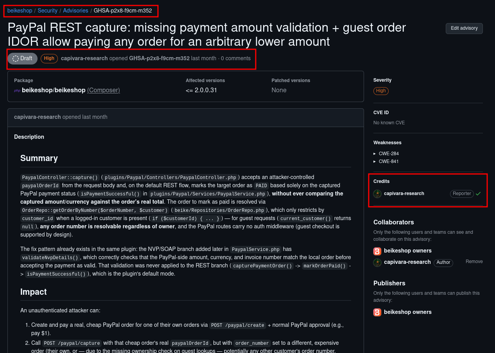

# GHSA-p2x8-f9cm-m352

## BeikeShop PayPal REST capture: missing payment amount validation and guest order IDOR

Public research reference for the security report privately submitted to the BeikeShop maintainers through GitHub Security Advisories.

- Advisory: [GHSA-p2x8-f9cm-m352](https://github.com/beikeshop/beikeshop/security/advisories/GHSA-p2x8-f9cm-m352)
- Product repository: [`beikeshop/beikeshop`](https://github.com/beikeshop/beikeshop)
- Affected product: BeikeShop
- Affected versions: `<= 2.0.0.31`
- Tested revision: `f41f390` (`v2.0.0.31`), PayPal plugin `v1.1.0`
- Weaknesses: CWE-841, CWE-284
- Severity: High
- Suggested CVSS: `8.2 — CVSS:3.1/AV:N/AC:L/PR:N/UI:N/S:U/C:L/I:H/A:N`
- VulDB submission: [Submit #1038160](https://vuldb.com/submit/1038160)
- Status: Reported privately to the vendor; CVE requested through VulDB
- Researcher credit: **Fernando Viana - Capivara Research**

## Submission evidence

The screenshot below records the private GitHub Security Advisory submission, affected version, severity, and reporter attribution.

## Disclosure note

The issue was reported privately to the vendor. No fixed version or vendor patch was known when this public reference was updated.

## Technical summary

The default PayPal REST capture flow accepts a caller-provided PayPal order ID and local order number. It treats a PayPal `COMPLETED` status as sufficient to mark the selected local order paid without verifying the captured amount, currency, or a server-side binding between those two orders. Guest order lookup also omits the customer ownership filter.

| Item | Value |
|---|---|
| Endpoint | `POST /paypal/capture` |
| Attacker-controlled parameters | `paypalOrderId` and `order_number` |
| Controller | `plugins/Paypal/Controllers/PaypalController.php::capture()` / `markOrderPaid()` |
| Payment validation | `plugins/Paypal/Services/PaypalService.php::isPaymentSuccessful()` |
| Order lookup | `beike/Repositories/OrderRepo.php::getOrderByNumber()` |
| Attacker | Unauthenticated guest-checkout user with a genuine low-value PayPal Sandbox transaction |

The demonstrated security boundary is transaction-to-order binding: a completed payment for one low-value order must not authorize a different local order to become `PAID`.

## Reproduction material

A complete, parameterized reproduction guide for an authorized local BeikeShop installation with PayPal Sandbox is available in [`poc/`](./poc/). It includes the capture request and a non-invasive affected-source verifier. No real payment credentials or production target data are included.

## Expected secure behavior

The capture handler must compare the PayPal-side amount and currency with the authoritative local order, verify a server-side transaction-to-order binding, and require a per-order guest capability rather than treating a plaintext order number as authorization.

## References

- [BeikeShop product repository](https://github.com/beikeshop/beikeshop)
- [Private GitHub advisory](https://github.com/beikeshop/beikeshop/security/advisories/GHSA-p2x8-f9cm-m352)
- [VulDB submission #1038160](https://vuldb.com/submit/1038160)
- [CWE-841](https://cwe.mitre.org/data/definitions/841.html)
- [CWE-284](https://cwe.mitre.org/data/definitions/284.html)
